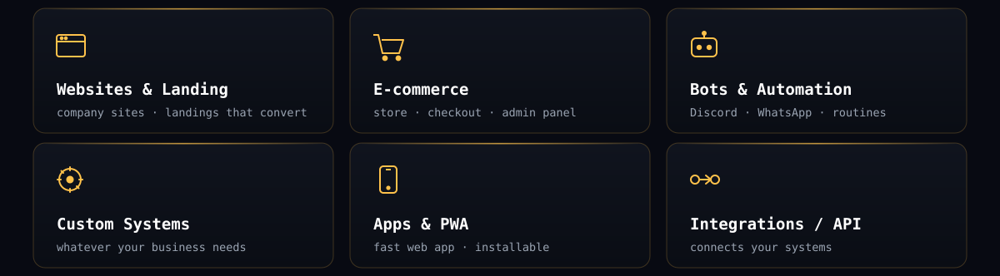
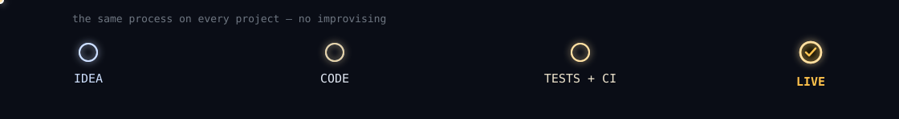

<div align="center">



<!-- the snake walks through the contributions — updated automatically by GitHub Actions -->
<picture>
  <source media="(prefers-color-scheme: dark)" srcset="https://raw.githubusercontent.com/estevaoradis-pixel/estevaoradis-pixel/output/snake-dark.svg">
  <source media="(prefers-color-scheme: light)" srcset="https://raw.githubusercontent.com/estevaoradis-pixel/estevaoradis-pixel/output/snake.svg">
  
</picture>

</div>

## `01 ·` About me

**I take the idea and deliver it running.**

I build custom software — from the website that sells to the bot that automates. I don't deliver "works on my machine": tested code, with CI, built to run **24/7 without going down**.

## `02 ·` What I do

<div align="center">



</div>

## `03 ·` Why work with me

- **Actually tested** — automated tests + CI. It doesn't break when the client uses it.
- **Built for production** — runs 24/7, with automatic deploys and monitoring.
- **From zero to live** — code, tests, deployment and whatever comes next: I handle all of it.

## `04 ·` Stack

```text
LANGUAGES    JavaScript · TypeScript · Python
FRONT-END    React · Next.js · responsive · PWA
BACK/DATA    Node · Supabase / Postgres · REST APIs
QUALITY      automated tests · CI · continuous deployment
RUNS ON      Railway · Vercel · 24/7
```

## `05 ·` How it ships

<div align="center">



</div>

## `06 ·` Let's talk

Have an idea — or a problem software can solve? **Reach out. Free, no-obligation quote.**

<div align="center">

[](https://wa.me/5527998843105)

[](mailto:estevao_radis@hotmail.com)

</div>
